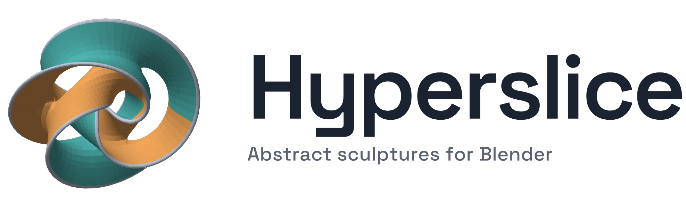
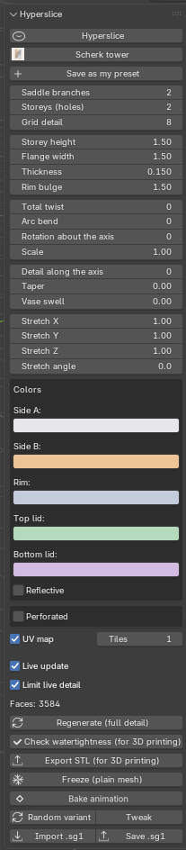
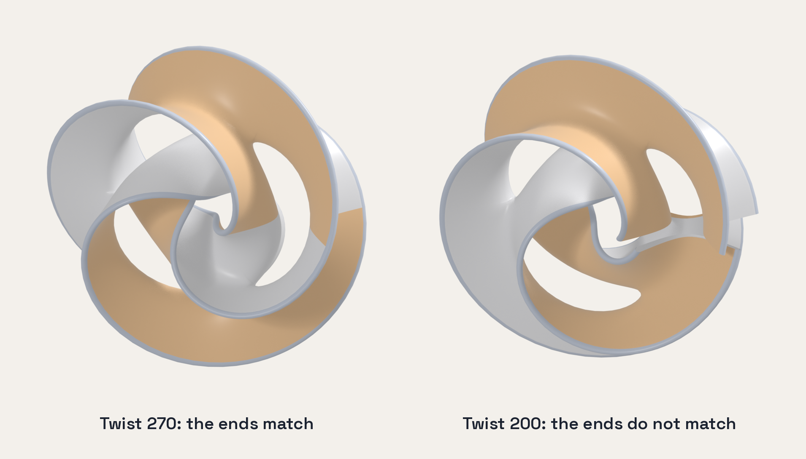
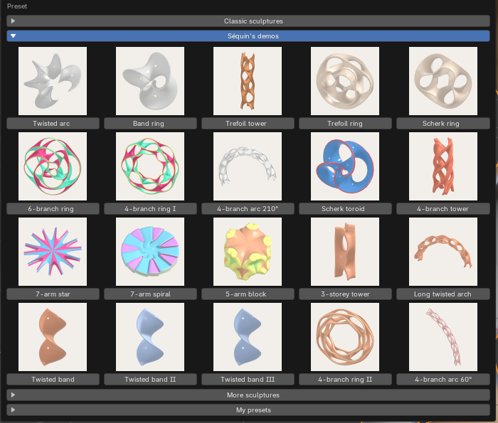

<p align="center"></p>

# Hyperslice

**Install from Blender Extensions:** in Blender open *Edit > Preferences > Get Extensions*, search for "Hyperslice", or visit https://extensions.blender.org/add-ons/hyperslice/

A Blender add-on that generates abstract sculptures from **Scherk towers**: surfaces with saddle-shaped holes that can be stacked, twisted and bent until they close into rings. It is a port of the geometry of **Sculpture Generator 1** by Carlo H. Séquin (UC Berkeley), rebuilt for Blender in Python/numpy and extended.

Parameters update in real time and the result is always an ordinary mesh, ready for rendering or 3D printing.

| | |
|---|---|
|  |  |

## Features

- Towers with 1 to 10 saddle branches, any number of storeys; thickness with shaped rims; end caps.
- Total twist, arc bend up to closed and double rings (Collins' toroidal closure), with a warning and the twist values that make the ends match.
- Beyond the original: detail along the axis, taper, vase swell, stretch angle, overall scale.
- **Perforated**: turns the surface into an irregular Voronoi-like lattice, with non-destructive modifiers.
- 33 presets with thumbnails, including Séquin's 20 demo sculptures; save your own presets.
- Five materials per sculpture (side A, side B, rim, top lid, bottom lid) with colour pickers; optional mirror-like surface; UV map.
- Random variant and Tweak buttons to explore.
- Reads and writes the original `.sg1` parameter files (extra Hyperslice lines are written at the end, where the original program ignores them).
- Watertightness check and binary STL export scaled to the size you want in millimetres.
- Bake animation: animated parameters (keyframes or drivers) are baked into shape keys; Freeze to get a plain mesh.
- Interface in English, Italian, French, German and Spanish (follows Blender's language).



## Install

**Blender 4.2 or later.** No external libraries needed.

1. Download the zip from the [Releases](../../releases) page.
2. In Blender: *Edit ▸ Preferences ▸ Add-ons ▸ Install from Disk…* and choose the zip
   (use `hyperslice-X.Y.Z-extension.zip` on Blender 4.2+; `hyperslice-X.Y.Z.zip` is the classic add-on package).
3. Open the sidebar (**N**) ▸ *Hyperslice*, or use *Add ▸ Mesh ▸ Hyperslice*.

## Manual

User manuals (English and Italian) are in [`docs/`](docs/).

## Building the zips

```
python3 tools/build.py
```

writes both zips into `dist/`. The version comes from `hyperslice/blender_manifest.toml` and must match `bl_info` in `hyperslice/__init__.py`.

## License and credits

Hyperslice is free software, released under the **GNU General Public License, version 3 or later** (see [`LICENSE`](LICENSE)).

The geometry is a Python/numpy port of the geometry code of *Sculpture Generator 1* by Carlo H. Séquin (University of California, Berkeley), released under the GPL with his permission (e-mails of 2 and 18 November 2026). The Scherk–Collins sculptures are by Brent Collins. Reference: <https://people.eecs.berkeley.edu/~sequin/SCULPTS/scherk.html>

**Hyperslice is not supported or endorsed by Carlo Séquin or by the University of California, Berkeley.**

Author: Costantino Vita ("Drakan"), with Claude (Anthropic).
Contact: hyperslice.addon@gmail.com — or open an [issue](../../issues).

---

## Italiano

Addon Blender per generare sculture astratte da **torri di Scherk**: superfici con fori a sella, impilabili, torcibili e piegabili fino a chiuderle in anelli. È una riscrittura per Blender della geometria dello **Sculpture Generator 1** di Carlo H. Séquin (UC Berkeley), con diverse aggiunte: traforatura a reticolo, 33 preset con miniature, preset personali, colori per parte, variante casuale, esportazione STL in millimetri e interfaccia in cinque lingue.

**Installazione** (Blender 4.2 o successivo): *Edit ▸ Preferences ▸ Add-ons ▸ Install from Disk…* e scegliere lo zip dalla pagina [Releases](../../releases); poi barra laterale (**N**) ▸ *Hyperslice*.

**Installazione da Blender Extensions:** in Blender aprire *Edit > Preferences > Get Extensions*, cercare "Hyperslice", oppure visitare https://extensions.blender.org/add-ons/hyperslice/

**Licenza:** GNU GPL versione 3 o successiva, con il permesso di Séquin per la parte derivata dal suo programma. Hyperslice non è sostenuto né approvato da Séquin o dall'Università della California. Il manuale in italiano è in [`docs/`](docs/). Contatti: hyperslice.addon@gmail.com, oppure aprire una [issue](../../issues).
